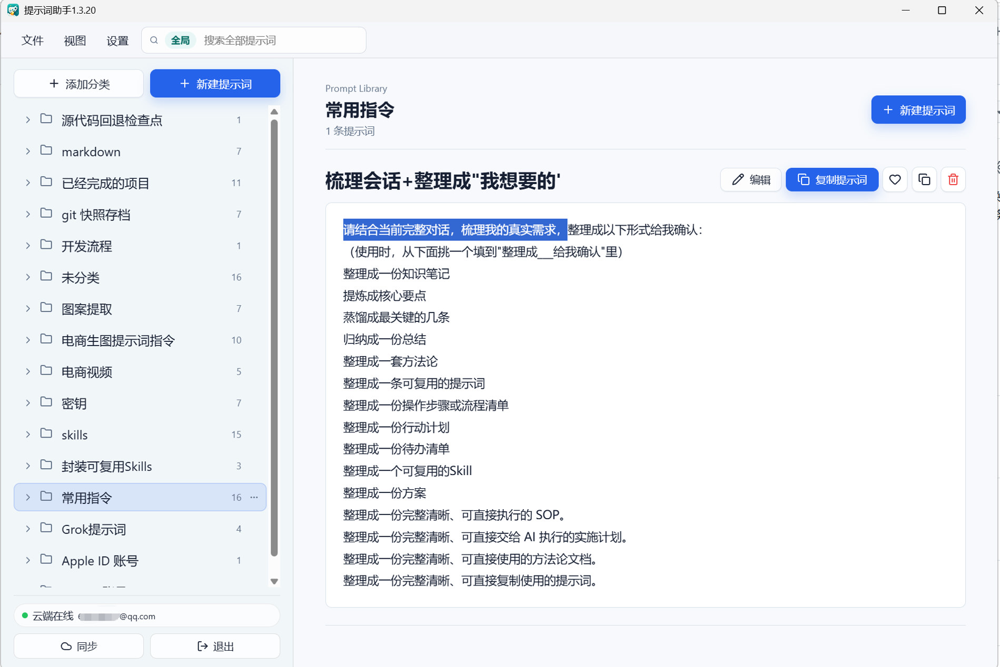

# 提示词助手

Windows 桌面工具，用来管理、分类、编辑、复制、导入导出提示词，也能把 Word、PDF、记事本、Markdown 等文件放进文档库，一键复制文件发给别人。数据默认存在本机。需要多设备同步时，连接你自己的 Supabase。需要安装版自动更新时，把安装包放到你自己的 HTTPS 目录。

本仓库是源代码。别人可以克隆后换成自己的服务器，再继续改功能和发自己的版本。



## 环境

- Windows
- Node.js 20 或更新版本

## 本地运行

```bash
npm install
copy .env.example .env
npm run dev
```

另开一个终端启动桌面窗口：

```bash
npm run desktop:dev
```

`.env` 留空也可以。这时没有云同步，安装版也不会检查更新。

## 换成自己的 Supabase

1. 在 [Supabase](https://supabase.com) 新建项目。
2. 打开 SQL Editor，执行仓库里的 `supabase-schema.sql`。
3. 在 `.env` 填写 `VITE_SUPABASE_URL` 和 `VITE_SUPABASE_ANON_KEY`。使用 publishable key 或 anon key。不要把 `service_role` key 写进 `.env` 后打包进客户端。
4. 重新执行 `npm run dev` 或重新打包。构建时这两个值会进入前端产物。
5. 对外分发前，把你的登录邮箱写进 `VITE_ADMIN_EMAILS`。填写后，只有这些账号能在软件里改云端配置。留空时，使用这台电脑的人可以直接改。

每个登录用户只能读写自己的 `prompt_libraries` 行。

文档库的文件本体存在 Supabase Storage 的私有 bucket `prompt-attachments` 里，每个用户只能读写自己目录下的文件，单个文件不超过 50MB。从旧版本升级后，在 SQL Editor 重新执行一次 `supabase-schema.sql` 就会开启文件同步。没开启时，文字和分类照常同步，文件只存在本机。

## 换成自己的更新服务器

自动更新只支持 Windows 安装版。便携版和 `release/win-unpacked/` 需要手动替换。

1. 准备一个 HTTPS 目录，例如 `https://你的域名/prompt-assistant-updates/win`。
2. 把这个地址写进 `.env` 的 `UPDATE_BASE_URL`。
3. 打包：

```bash
npm run package:all
```

打包前脚本会把 `UPDATE_BASE_URL` 写进 `electron/app-update-source.local.json`。这个文件已被忽略，不会进入 Git。没有地址时，安装版会提示未配置更新地址。

4. 把下面三个文件放到你的 HTTPS 目录：

```text
release/latest.yml
release/提示词助手安装版X.Y.Z.exe
release/提示词助手安装版X.Y.Z.exe.blockmap
```

5. 以后发新版本时，先提高 `package.json` 里的 `version`，以及界面标题和安装包文件名里的同一版本号，再重新打包并替换服务器上的这三个文件。先传安装包和 blockmap，最后传 `latest.yml`。目录里只保留当前版本的安装包和 blockmap。

也可以用 SSH 上传。在 `.env` 填写：

```text
UPDATE_SERVER_HOST
UPDATE_SERVER_USER
UPDATE_SERVER_SSH_KEY
UPDATE_SERVER_REMOTE_DIR
UPDATE_BASE_URL
```

然后执行：

```bash
npm run publish:update
```

`npm run release:publish` 会先打包，再执行上面的上传。服务器必须能用 SSH 私钥登录，并且 `UPDATE_BASE_URL` 能公开访问刚上传的文件。

## 版本迭代

改了会被打包的源码后：

1. 把 `package.json` 的 `version`、`productName`、安装包文件名、快捷方式名，以及 `index.html` 标题里的版本一起加一号。
2. 运行 `npm test`。
3. 运行 `npm run package:all`，确认安装版、便携版和 `release/win-unpacked/` 都在。
4. 把新的安装包发布到你自己的更新地址。

## 不要提交

- `.env`、Supabase `service_role` key、SSH 私钥
- `node_modules/`、`dist/`、`release/`
- `electron/app-update-source.local.json`

## 许可

MIT，见 `LICENSE`。
